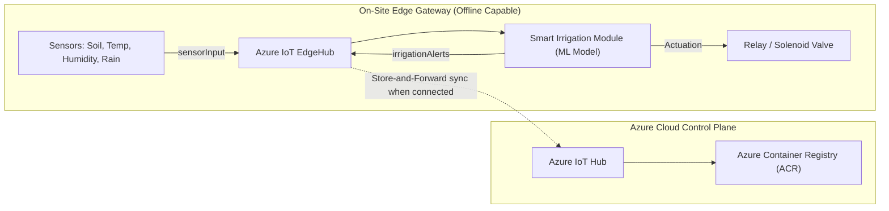

# Smart Agriculture: Edge ML Irrigation Decision System

[](https://learn.microsoft.com/azure/iot-edge/)
[](https://www.python.org/)
[]()
[]()

> **Scenario**: Farms have poor or intermittent connectivity, so irrigation decisions must be made **on-site** without cloud latency or dependency.  
> **Task**: Train a machine learning classification model on `soil_moisture`, `temperature`, `humidity`, and `rainfall` to output **"irrigate"** vs. **"don't irrigate"**, and deploy it as an **Azure IoT Edge module** managed via **Azure IoT Hub**.

---

## 🌾 Solution Architecture



- **Zero Cloud Dependency for Decisions**: The trained ML pipeline runs locally inside the edge container in **0.54 milliseconds**.
- **Store-and-Forward Buffering**: If 4G/LTE or satellite goes down, `edgeHub` buffers decision telemetry locally (TTL up to 7 days) and automatically syncs when the link restores.
- **Remote Twin Management**: Operators can calibrate sensor biases and toggle operating modes (`autonomous`, `manual_override`, `eco`) from Azure IoT Hub.

---

## 📁 Repository Structure

```
AEAL/
├── data/
│   ├── generate_dataset.py          # Agronomy-grounded FAO-56 dataset generator
│   └── smart_irrigation_data.csv    # Generated 4,000-sample dataset
├── model/
│   ├── train.py                     # Multi-model benchmarking, CV, and export script
│   ├── evaluate.py                  # Full evaluation, confusion matrix & latency test
│   ├── irrigation_model.joblib      # Serialized Scikit-Learn pipeline
│   └── model_metadata.json          # Metrics, parameters, and feature importances
├── edge_module/
│   ├── main.py                      # Azure IoT Edge Module entrypoint (IoTHubModuleClient)
│   ├── predictor.py                 # Self-contained edge inference engine & reasoning
│   ├── sensor_simulator.py          # Realistic field sensor diurnal simulator
│   ├── irrigation_model.joblib      # Bundled edge model artifact
│   ├── model_metadata.json          # Bundled metadata
│   ├── Dockerfile                   # Multi-stage lightweight Linux container
│   ├── Dockerfile.arm64v8           # Raspberry Pi 4/5 & ARM64 gateway container
│   ├── module.json                  # Azure IoT Edge build & platform manifest
│   └── requirements.txt             # Python dependencies for edge module
├── deployment/
│   ├── deployment.template.json     # Azure IoT Edge deployment manifest template
│   ├── test_local_edge.py           # Comprehensive local verification harness
│   └── setup_azure_iot_hub.sh       # Automated Azure CLI provisioning & deployment script
├── docs/
│   └── ARCHITECTURE.md              # Deep-dive architecture and design documentation
├── requirements.txt                 # Top-level dependencies
└── README.md                        # Documentation and user guide
```

---

## 📊 Model Performance & Metrics

Evaluated on held-out test data (800 samples):

| Metric | Result |
|---|---|
| **Best Model** | **Gradient Boosting Classifier** (with StandardScaler Pipeline) |
| **Test Accuracy** | **98.25%** |
| **Precision** | **96.57%** |
| **Recall** | **95.48%** |
| **F1-Score** | **96.02%** |
| **ROC-AUC** | **0.9993** |
| **Average Single-Sample Latency** | **0.54 ms** |

### Feature Importance
- **Soil Moisture**: **56.32%** (Primary driver of plant-available water)
- **Rainfall**: **21.90%** (Physical hard override to avoid waterlogging)
- **Temperature**: **16.88%** (Evapotranspiration driver)
- **Humidity**: **4.89%** (Vapor pressure deficit regulator)

---

## 🚀 Quick Start Guide

### 1. Set Up Environment

```bash
# Navigate to workspace
cd /Users/macbook/Desktop/AEAL

# Create and activate virtual environment
python3 -m venv .venv
source .venv/bin/activate

# Install dependencies
pip install -r requirements.txt
```

### 2. Generate Dataset & Retrain Model (Optional)

```bash
# Generate synthetic FAO-56 dataset
python data/generate_dataset.py

# Train and export optimized ML pipeline
python model/train.py

# Run comprehensive evaluation
python model/evaluate.py
```

### 3. Verify Edge Model Locally

Run the complete local edge verification test (validates edge predictor, agronomic test cases, and edge latency without needing cloud access):

```bash
python deployment/test_local_edge.py
```

To run a dynamic simulated sensor run across morning, heatwave, storm, and recovery phases:

```bash
python edge_module/sensor_simulator.py
```

---

## ☁️ Azure IoT Hub & IoT Edge Deployment

### Automated Deployment Script

The provided script `deployment/setup_azure_iot_hub.sh` automates the entire Azure configuration using the Azure CLI:
1. Creates Azure Resource Group and Azure IoT Hub (S1 Standard).
2. Creates Azure Container Registry (ACR).
3. Builds the edge Docker container directly in the cloud using **ACR Cloud Build** (no local Docker daemon required!).
4. Registers an IoT Edge Device (`farm-edge-gateway-01`).
5. Generates the deployment manifest and applies it to the device using `az iot edge set-modules`.

To run:

```bash
# Set parameters (or use defaults)
export RESOURCE_GROUP="rg-smart-agri-edge"
export LOCATION="eastus"
export IOT_HUB_NAME="iothub-agritech-farm"
export ACR_NAME="acragritechfarm"
export EDGE_DEVICE_ID="farm-edge-gateway-01"

# Execute setup
bash deployment/setup_azure_iot_hub.sh
```

---

## 🛠️ Provisioning the On-Site Edge Gateway (e.g., Raspberry Pi)

On the physical field gateway running Linux with the `aziot-edge` package installed:

1. Open the IoT Edge configuration file:
   ```bash
   sudo nano /etc/aziot/config.toml
   ```

2. Configure manual connection string provisioning using the connection string output by the setup script:
   ```toml
   [provisioning]
   source = "manual"
   connection_string = "HostName=iothub-agritech-farm.azure-devices.net;DeviceId=farm-edge-gateway-01;SharedAccessKey=..."
   ```

3. Apply configuration and restart services:
   ```bash
   sudo iotedge config apply
   ```

4. Verify edge modules are running:
   ```bash
   sudo iotedge list
   ```

---

## 📡 Live Telemetry & Remote Control

### 1. Monitor Decision Telemetry in Real-Time
Stream events reaching Azure IoT Hub from the edge module:
```bash
az iot hub monitor-events --hub-name <IOT_HUB_NAME> --device-id farm-edge-gateway-01
```

### 2. Trigger On-Demand Inference (Direct Method)
Invoke an immediate on-site irrigation evaluation from the cloud:
```bash
az iot hub invoke-module-method \
    --hub-name <IOT_HUB_NAME> \
    --device-id farm-edge-gateway-01 \
    --module-id irrigationDecisionModule \
    --method-name RunInference \
    --method-payload '{"soil_moisture": 14.5, "temperature": 36.0, "humidity": 25.0, "rainfall": 0.0}'
```

### 3. Update Remote Configuration (Module Twin)
Change the operating mode or moisture calibration remotely:
```bash
az iot hub module-twin update \
    --hub-name <IOT_HUB_NAME> \
    --device-id farm-edge-gateway-01 \
    --module-id irrigationDecisionModule \
    --desired '{"mode": "manual_override", "moisture_bias_offset": 2.0}'
```

