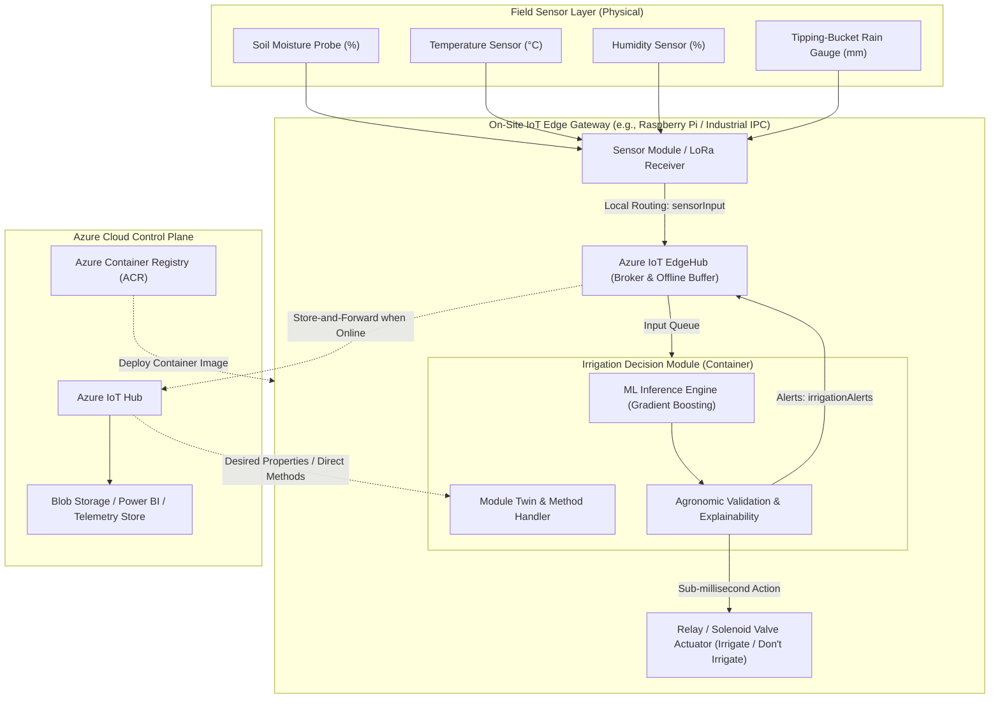
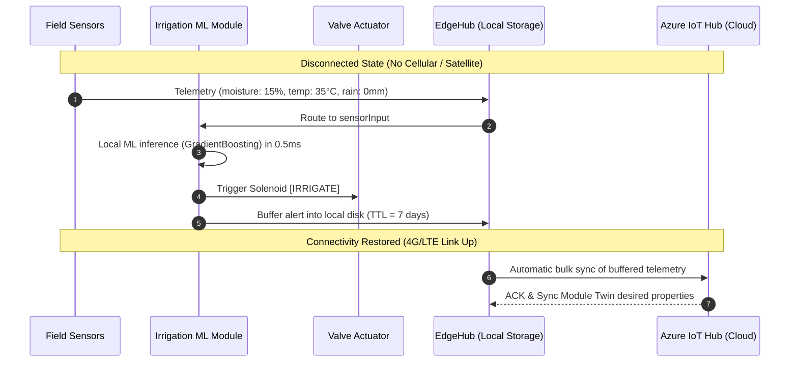

# Smart Agriculture: Offline-First Edge ML Irrigation Architecture

## 1. Problem Statement & Motivation
In rural and agricultural areas, cellular and satellite connectivity is often intermittent, low-bandwidth, or completely absent. However, irrigation decisions must occur in real time:
- **Delaying irrigation** during high evaporative demand causes crop wilting and irreversible yield loss.
- **Over-irrigating** during sudden rain events leads to root rot, nutrient leaching, and wasted water.

To overcome this, the Machine Learning decision model is deployed **directly on-site** as an **Azure IoT Edge Module**. The edge device autonomously decides whether to open or close irrigation valves in **sub-millisecond latency (<1.5 ms)** without requiring an active internet connection.

---

## 2. System Architecture

---

## 3. Offline Store-and-Forward Resilience

Azure IoT Edge incorporates a local message broker (`edgeHub`) that functions entirely disconnected from the cloud:

---

## 4. Machine Learning Pipeline & Agronomic Grounding

The model classifies field conditions into binary decisions:
- **`1` (Irrigate)**: Soil water depleted below Management Allowed Depletion (MAD), accelerated by high vapor pressure deficit (high temperature, low humidity).
- **`0` (Don't Irrigate)**: Soil has adequate moisture, or significant precipitation is detected.

### Feature Weights & Physical Roles:
1. **Soil Moisture (56.3%)**: Primary indicator of available water capacity (AWC). Values below ~18% present acute wilting hazards.
2. **Rainfall (21.9%)**: Immediate hard override. If rainfall $\ge 4.0\text{ mm}$, irrigation is suspended to prevent waterlogging.
3. **Temperature (16.9%)**: Direct driver of potential evapotranspiration (ET₀).
4. **Humidity (4.9%)**: Regulates atmospheric vapor pressure deficit.

### Model Benchmarks
- **Model**: Scikit-Learn Gradient Boosting Pipeline with StandardScaler
- **Accuracy**: 98.25%
- **F1-Score**: 96.02%
- **ROC-AUC**: 0.9993
- **Inference Latency**: 0.54 ms per single-sample prediction

---

## 5. Module Twin & Remote Cloud Control

Operators manage on-site parameters remotely through the Azure IoT Hub Module Twin:

| Desired Property | Type | Default | Description |
|---|---|---|---|
| `mode` | string | `"autonomous"` | `"autonomous"`, `"manual_override"`, or `"eco"` |
| `moisture_bias_offset` | float | `0.0` | Calibrates sensor drift without retraining |
| `min_confidence_threshold`| float | `0.60` | Minimum confidence required to trigger valve |
| `telemetry_interval_sec` | int | `5` | Upstream telemetry frequency |
